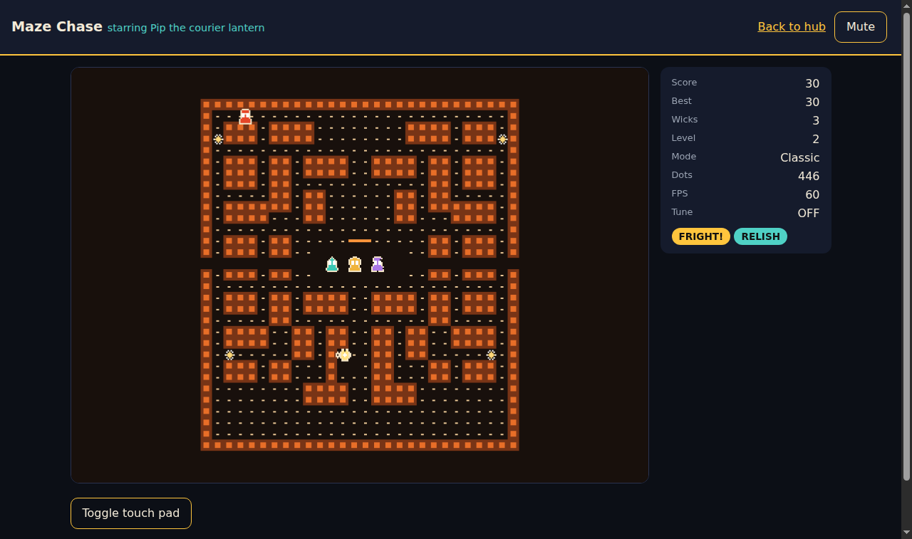

# Maze Chase: browser install and launch guide

Play the same engine in a browser tab: `maze-chase/play.html` drives the
`maze-chase-web` Rust crate compiled to WebAssembly, with keyboard plus
touch controls, DPR-aware canvas sizing, and WebAudio sound. No gameplay
logic lives in the page or the harness: the `.wasm` owns the session,
the scores table, settings state, and every board pixel; JavaScript maps
input, paints DOM, and synthesizes audio from the crate's data tables.



## Launch

The page must be served over http: browsers refuse `fetch()` of the
`.wasm` over `file://`, and the harness shows a styled error card (never
a blank page) when the engine cannot load.

```
# Inside maze-chase/ (serves play.html at /play.html):
python3 -m http.server 8000
# Open http://localhost:8000/play.html
```

On GitHub Pages the committed build plays from the project hub: open
the hub `index.html`, press Play. The shipped artifact is
`maze-chase/web/maze-chase.wasm` (about 190 KB, zero imports, fully
self-contained), built reproducibly (see below); `web/maze-chase.js` is
the harness (plain script, no bundler, no external resources, works
offline once served).

## Controls

Keyboard (remappable in Settings; arrows move DOM focus in menus,
Enter/Space activates the focused button):

| Key | Play | Menus |
|---|---|---|
| Arrows / WASD | Steer Pip | Move button focus |
| P or Esc | Pause | Back |
| M | Mute toggle | Mute toggle |
| Enter / Space | - | Activate focused button |

Touch: swipe on the board to steer (24 px deadzone, dominant axis
wins, so taps never turn Pip); an on-screen direction pad appears on
coarse pointers (or via "Toggle touch pad"); tapping a panel's primary
button activates it. There is no gamepad API on the web layer by design:
keyboard plus touch is the full control scheme (see the matrix).

## Screens

Title (Start, Help, Scores, Settings), Help, Scores (machine top-10
with rank/name/score/level), Settings (volumes, reduced flash, theme,
difficulty, mute, key remap), Pause (Resume, Restart, Quit to title),
Game over (score/level/best, name entry when the run qualifies, Play
again). The canvas behind the panels shows the live board: the attract
demo on title, the frozen hunt on pause, the final board on game over.

## Audio

Sound starts on the first click, keypress, or touch (browser autoplay
policy; the harness unlocks the AudioContext on first gesture). Every
cue the engine emits is synthesized from the audio crate's own data:
SFX recipes (waveform plus frequency sweep plus length) per cue with
pitch doubling per warden chain, and the five original tunes (title and
fright loops plus death/clear/game-over stings) at the shared 132 BPM
tempo. Master/music/SFX sliders and mute persist; if WebAudio is absent
the game plays silent with a note in the HUD.

## Settings and scores

Both persist in `localStorage` (`maze-chase-settings` holds the exact
config blob the native layers write to disk; `maze-chase-scores` holds
the table rows). Corrupt blobs are ignored with Rust defaults kept, and
private browsing simply does not persist. The name entry caps at 12
characters and falls back to "Pip" when blank.

Key remap policy differs from desktop in one documented way: the shared
config rejects duplicate bindings, and every hardware key is bound by
default, so the web layer *moves* a taken key from its previous owner
(which keeps its remaining twins) instead of rejecting the bind. The
move is refused only when the previous owner would be left keyless. The
settings panel always shows the live Rust-side bindings.

## Canvas and resize

The board renders at the terminal bitmap density (224 by 248 logical
pixels, identical composition: walls, crumbs, sunseed pulse, relish
bob, fright masks with flash staging, eye pairs, chomp and death
clips), integer-scaled and letterboxed onto the canvas backing store,
which tracks CSS size times DPR (capped at 2). Resize and orientation
changes re-fit live; below the 280 px CSS minimum the board clips
centered rather than reflowing. HUD text (score, best, wicks, level,
mode, dots, FPS, tune, fright/relish badges) is DOM, updated at 4 Hz.

Two honest display notes, both engine-faithful, not harness bugs: a
fresh board reads Dots 448 with Score 10 because Pip's spawn crumb is
eaten at construction (the engine banks the 10 silently, event-free);
and the attract demo behind the title panel is a real fresh engine game,
so the HUD previews that state until you press Start.

## Verification

- `cargo test -p maze-chase-web`: 42 tests (board composition and
  determinism, canvas fit/blit math, keyboard/touch mapping, rebind
  steal rules, score table, cue/SFX/tune routing, session flow,
  hostile bridge probes).
- Node instantiation of the release `.wasm`: zero imports, scoring
  through the real ABI, bit-identical frames across instances, audio
  tables resolving from crate data.
- Headless-chromium E2E over CDP against the served page: boot with
  zero console errors, title visible with no focus scroll, canvas
  paints varied pixels, real button click starts play, real ArrowUp
  keypresses score, P pauses and Resume returns, touch swipe keeps the
  game alive, mobile viewport (390 by 844) shows the board near the
  top. Rerun any time from `maze-chase/`: `node web/e2e/wasm-smoke.js`
  then (with the http server plus CDP chromium up, see
  `web/e2e/README.md`) `node web/e2e/browser-e2e.js`.

## Troubleshooting

- Error card "Could not load the game engine": you opened `play.html`
  from disk. Serve the directory over http (above) and reload.
- "Version mismatch": the page and the `.wasm` disagree. Rebuild the
  crate (below) so `web/maze-chase.wasm` matches `web/maze-chase.js`.
- Silent audio: the browser blocked the context (look for the HUD
  note), or volumes are at zero in Settings.
- Tiny board on a huge monitor: the canvas follows its container up to
  DPR 2; widen the window and it re-fits.
- Lost scores after clearing browser data: expected; the table lives in
  `localStorage`, cleared with site data.

## Reproducible builds

Stock stable Rust, no `wasm-bindgen`, no extra tooling: the `.wasm`
must be byte-reproducible from a clean checkout.

```
rustup target add wasm32-unknown-unknown
cargo build --release --target wasm32-unknown-unknown -p maze-chase-web
cp target/wasm32-unknown-unknown/release/maze_chase_web.wasm maze-chase/web/maze-chase.wasm
```

The committed `web/maze-chase.wasm` is that exact artifact. The bridge
ABI version (`mc_version() == 1`) gates the harness: mismatched pairs
fail loudly on the error card instead of misbehaving.
